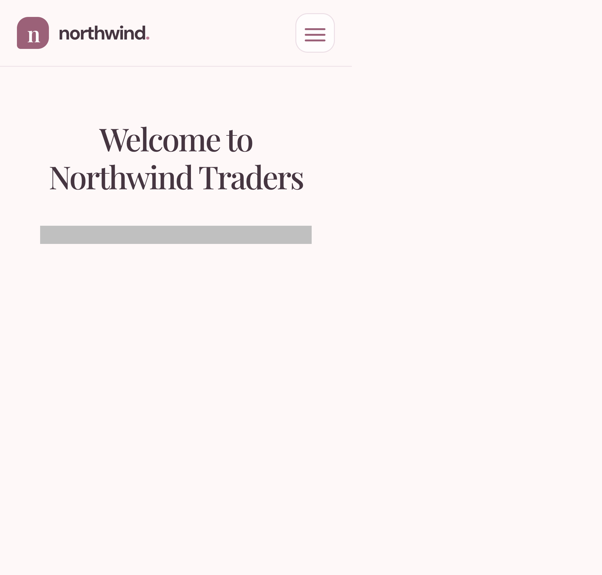

## Author : Salma Mohamed

# Module 7 SQL Challenge

This lab uses SQLite and the Northwind sample database to practice basic SQL statements.

## Challenge Files

- `Module7Challenge.sql` — SQL statements for the seven challenge tasks.
- `Module7ChallengeOutput.txt` — Output captured while running the challenge.
- `northwind.db` — SQLite database used for the exercises.

## Key Terms

- **Statement:** One complete instruction written in SQL. It ends with a semicolon.
- **Query:** A `SELECT` statement that asks the database for data.
- **Table:** A set of rows and columns that holds one kind of data, such as customers.
- **Column:** One kind of information in a table, such as a phone number.
- **Row:** One record in a table, such as one customer.
- **Terminal:** A window where you type commands.

## Run the Challenge

```bash
sqlite3 -echo -header -column northwind.db < Module7Challenge.sql 2>&1 | tee Module7ChallengeOutput.txt
```


# Module 9 Lab

# C# Database Development Notes plus Module 9 C# webapp showing List of customers from Northwind database

My learning notes on **LINQ**, **Entity Framework Core (EF Core)**, and
**ADO.NET** --- three important technologies for working with databases
in C# and .NET.

## Table of Contents

-   [1. LINQ](#1-linq-language-integrated-query)
-   [2. Entity Framework Core](#2-entity-framework-core-ef-core)
-   [3. ADO.NET](#3-adonet)
-   [4. Comparison](#4-comparison)
-   [5. How They Work Together](#5-how-they-work-together)
-   [6. Suggested Learning Order](#6-suggested-learning-order)
-   [7. Practice Project](#7-practice-project)

------------------------------------------------------------------------

## 1. LINQ (Language Integrated Query)

LINQ lets you query, filter, sort, group, and transform data using C#
syntax.

You can use LINQ with in-memory collections (such as lists) and with
data providers such as EF Core.

### Example: Filter a list

``` csharp
using System;
using System.Collections.Generic;
using System.Linq;

List<string> students = new List<string>
{
    "Salma", "John", "Mary", "Ahmed"
};

var results = students
    .Where(name => name.StartsWith("S"))
    .ToList();

foreach (var name in results)
{
    Console.WriteLine(name);
}
```

**Output:**

``` text
Salma
```

### Common LINQ methods

  -----------------------------------------------------------------------
  Method                              Purpose
  ----------------------------------- -----------------------------------
  `Where()`                           Filters items based on a condition

  `Select()`                          Projects each item into a new form

  `OrderBy()`                         Sorts items in ascending order

  `OrderByDescending()`               Sorts items in descending order

  `FirstOrDefault()`                  Returns the first matching item, or
                                      a default value

  `Count()`                           Counts items

  `GroupBy()`                         Groups items by a key

  `Any()`                             Checks whether any item matches a
                                      condition

  `ToList()`                          Executes a query and creates a list
  -----------------------------------------------------------------------

### Example: Query objects

``` csharp
var activeStudents = students
    .Where(student => student.IsActive)
    .OrderBy(student => student.Name)
    .Select(student => student.Name)
    .ToList();
```

> Note: This example assumes `students` is a collection of objects with
> `IsActive` and `Name` properties.

------------------------------------------------------------------------

## 2. Entity Framework Core (EF Core)

EF Core is an **object-relational mapper (ORM)**. It lets a .NET
application work with a database through C# classes and objects,
reducing the need to write SQL for routine database operations.

### Example: Create a model

``` csharp
public class Student
{
    public int Id { get; set; }
    public string Name { get; set; } = "";
    public string Email { get; set; } = "";
}
```

### Example: Define a DbContext

``` csharp
using Microsoft.EntityFrameworkCore;

public class SchoolContext : DbContext
{
    public SchoolContext(DbContextOptions<SchoolContext> options)
        : base(options)
    {
    }

    public DbSet<Student> Students => Set<Student>();
}
```

### Example: Add a student

``` csharp
var student = new Student
{
    Name = "Salma",
    Email = "salma@example.com"
};

_context.Students.Add(student);
await _context.SaveChangesAsync();
```

EF Core translates the change into the appropriate database operation
when `SaveChangesAsync()` is called.

### Example: Read students using LINQ

``` csharp
var students = await _context.Students
    .Where(student => student.Name.StartsWith("S"))
    .OrderBy(student => student.Name)
    .ToListAsync();
```

### Important EF Core concepts

-   **Entity/model:** A C# class that represents data.
-   **DbContext:** Represents a session with the database and
    coordinates queries and changes.
-   **DbSet:** Represents a collection of entities that can be queried
    and saved.
-   **Migrations:** Track model changes and help update the database
    schema.
-   **Relationships:** Define how entities relate, such as one-to-many
    and many-to-many.
-   **SaveChanges / SaveChangesAsync:** Persist tracked changes to the
    database.
-   **LINQ queries:** Express database queries in C#; EF Core translates
    supported expressions into SQL.

### Typical migration commands

Install the EF Core tools and the database provider appropriate for your
project first. Then, for a project using the EF Core CLI:

``` bash
dotnet ef migrations add InitialCreate
dotnet ef database update
```

------------------------------------------------------------------------

## 3. ADO.NET

ADO.NET is a lower-level .NET data-access technology. It gives you
direct control over database connections, SQL commands, parameters, and
reading results.

Unlike typical EF Core usage, you write the SQL statements yourself.

### Example: Read students from SQL Server

Install the `Microsoft.Data.SqlClient` package in your project.

``` csharp
using Microsoft.Data.SqlClient;

string connectionString = "YOUR_CONNECTION_STRING";

await using var connection = new SqlConnection(connectionString);
await connection.OpenAsync();

const string sql = "SELECT Id, Name, Email FROM Students";

await using var command = new SqlCommand(sql, connection);
await using var reader = await command.ExecuteReaderAsync();

while (await reader.ReadAsync())
{
    Console.WriteLine(reader["Name"]);
}
```

**Important:** Store connection strings securely (for example, in user
secrets or environment variables). Do not commit real credentials to
GitHub.

### Use parameters for user-provided values

Avoid building SQL by concatenating user input. Use parameters to help
prevent SQL injection.

``` csharp
const string sql = "SELECT Id, Name, Email FROM Students WHERE Email = @Email";

await using var command = new SqlCommand(sql, connection);
command.Parameters.AddWithValue("@Email", email);

await using var reader = await command.ExecuteReaderAsync();
```

### Common ADO.NET classes

  -----------------------------------------------------------------------
  Class                               Purpose
  ----------------------------------- -----------------------------------
  `SqlConnection`                     Opens a connection to SQL Server

  `SqlCommand`                        Executes SQL statements or stored
                                      procedures

  `SqlDataReader`                     Reads query results forward-only

  `SqlParameter`                      Supplies values safely to
                                      parameterized SQL commands

  `SqlTransaction`                    Groups operations into a
                                      transaction
  -----------------------------------------------------------------------

------------------------------------------------------------------------

## 4. Comparison

  ---------------------------------------------------------------------------
  Feature           LINQ                  EF Core           ADO.NET
  ----------------- --------------------- ----------------- -----------------
  Main purpose      Query and transform   Work with         Direct database
                    data                  databases through access
                                          an ORM            

  Main interface    C# query operators    Entities,         Connections,
                    and methods           `DbContext`, and  commands, and
                                          LINQ              readers

  SQL required      Depends on the data   Usually not for   Yes, for SQL
                    source                routine           commands
                                          operations        

  CRUD support      Depends on the        Built-in change   Implemented with
                    collection/provider   tracking and      SQL commands
                                          persistence       

  Level of          Query abstraction     Higher-level ORM  Lower-level data
  abstraction                                               access

  Control over SQL  Depends on the        Can use raw SQL   Direct control
                    provider              when needed       
  ---------------------------------------------------------------------------

**Key distinction:** LINQ is a query feature in .NET. EF Core is an ORM
that can translate supported LINQ queries into SQL. ADO.NET provides
lower-level database access APIs.

------------------------------------------------------------------------

## 5. How They Work Together

In a typical .NET application:

1.  The application uses **C#** for its business logic.
2.  **LINQ** expresses filtering, sorting, and projection.
3.  **EF Core** can translate LINQ queries into SQL and persist changes.
4.  **ADO.NET** can be used when direct, lower-level database access is
    appropriate.

For example, in a campaign management application, LINQ could filter
campaigns by status, EF Core could save campaign data, and ADO.NET could
execute a carefully parameterized SQL query for a specialized operation.

------------------------------------------------------------------------

## 6. Suggested Learning Order

A practical order for learning database development with C#:

1.  C# fundamentals and object-oriented programming (OOP).
2.  SQL fundamentals: `SELECT`, `INSERT`, `UPDATE`, `DELETE`, joins, and
    constraints.
3.  LINQ: filtering, projection, sorting, grouping, and async queries.
4.  EF Core: models, `DbContext`, relationships, migrations, and CRUD.
5.  ADO.NET: connections, commands, parameters, readers, and
    transactions.
6.  ASP.NET Core Web API: expose application functionality through HTTP
    endpoints.

------------------------------------------------------------------------

## 7. Practice Project

### Google Ads Campaign Management System

Build a C# application that helps local businesses organize and monitor
advertising campaigns.

**Possible features:**

-   Create and manage customer accounts.
-   Add, view, update, and delete advertising campaigns.
-   Record daily budgets and campaign spending.
-   Track clicks and impressions.
-   Calculate cost per click (CPC).
-   Filter campaigns by customer, status, or date.
-   Generate campaign performance reports.

**Suggested entities:**

  -----------------------------------------------------------------------
  Entity                              Example fields
  ----------------------------------- -----------------------------------
  Customer                            `Id`, `BusinessName`, `Email`

  Campaign                            `Id`, `CustomerId`, `Name`,
                                      `DailyBudget`, `Status`

  CampaignMetric                      `Id`, `CampaignId`, `Date`,
                                      `Clicks`, `Impressions`, `Spend`
  -----------------------------------------------------------------------

**Where the technologies fit:**

-   Use **LINQ** to filter campaigns and calculate report data.
-   Use **EF Core** to implement database-backed CRUD operations and
    relationships.
-   Use **ADO.NET** for optional exercises involving direct,
    parameterized SQL queries.

### Example CPC calculation

Cost per click (CPC) is calculated as:

``` text
CPC = Total Spend / Number of Clicks
```

Handle the case where clicks are zero to avoid division by zero.

------------------------------------------------------------------------

## Further Reading

-   [LINQ
    documentation](https://learn.microsoft.com/dotnet/csharp/linq/)
-   [Entity Framework Core
    documentation](https://learn.microsoft.com/ef/core/)
-   [ADO.NET
    documentation](https://learn.microsoft.com/dotnet/framework/data/adonet/)
-   [C# documentation](https://learn.microsoft.com/dotnet/csharp/)

------------------------------------------------------------------------

# screenshot of the website




